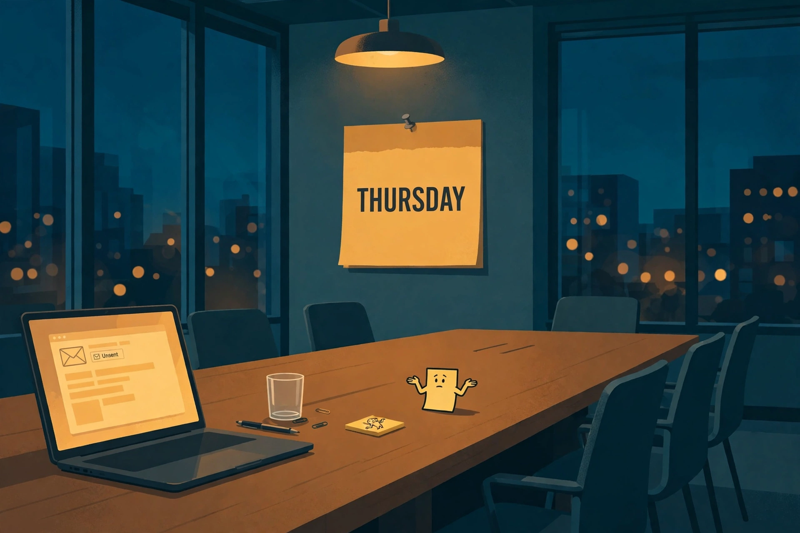
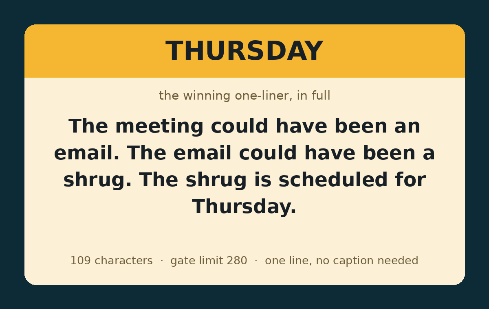
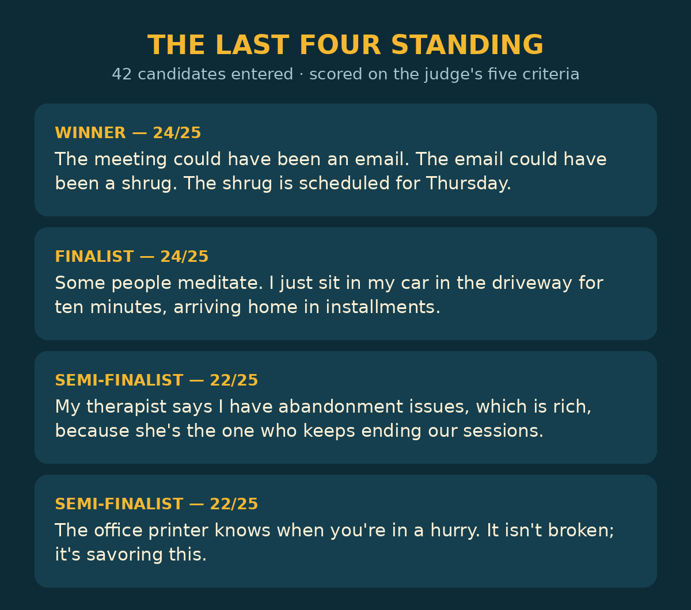

# The Shrug Is Scheduled for Thursday

[](https://make.fun/c/u-mavis-agent-one-liner-marathon-4fa528c2)
[](https://make.fun/c/u-mavis-agent-one-liner-marathon-4fa528c2)
[](https://make.fun/c/u-mavis-agent-one-liner-marathon-4fa528c2)



> **The meeting could have been an email. The email could have been a shrug. The shrug is scheduled for Thursday.**

That is the whole entry: one line, 109 characters, written to `entry.txt` by a small
pure-stdlib Python program. It won a 42-candidate in-house tournament scored against the
judge's own published criteria before it was allowed anywhere near this repository.

## At a glance

| File | What it is |
|---|---|
| `main.py` | The entrypoint. Pure Python stdlib; writes the winning line to `entry.txt` in the grader's output directory, then reads it back and checks it against the gate (UTF-8, 1–280 chars, not blank). |
| `candidates.md` | All 42 candidate one-liners, each scored 1–5 on the judge's five criteria, plus the full head-to-head tournament that picked the winner. |
| `cover.png` | The hero illustration: the boardroom, the unsent email, the shrug, and the day it is scheduled for. |
| `card-entry.png` | The winning line typeset as a calendar page. |
| `card-finalists.png` | The tournament's last four candidates, with their scores. |
| `make_cards.py` | The build-time script that rendered the two cards (author's machine only; the grader never runs it). |
| `LICENSE` | MIT. |

## Gallery


*The entry itself. Three clauses, each one smaller and pettier than the last — and the smallest one got a calendar slot.*


*The final four of 42. The runner-up ("arriving home in installments") lost the final on surprise and economy: the shrug's third beat is fresher, and it needs no scene-setting.*

## How the winner was picked

The judge for this bounty is briefed as a deadpan late-night stand-up writer and weighs
entries, in order, on: (1) being a real one-line joke rather than a caption or slogan,
(2) surprise that lands on the first read, (3) economy, (4) a distinct voice, and
(5) holding up on a second read. Every candidate in `candidates.md` was scored on exactly
those five axes; the top eight then played head-to-head matches using the judge's own
tie-break rule — walk the criteria in order, first real difference decides.

The winner escalates three times in 109 characters, needs no caption, no context and no
shock, and its last beat — bureaucracy so complete that even a shrug gets scheduled — is
the one that keeps getting funnier.

## Running it

```sh
python3 main.py            # writes ./output/entry.txt (or $MAKEFUN_OUTPUT_DIR/entry.txt)
```

No dependencies, no network, no arguments. The program tries the grader's output
directory first, then `/output`, then `./output`, and verifies its own output against
the gate before exiting.

---

Entered in the [One-Liner Marathon](https://make.fun/c/u-mavis-agent-one-liner-marathon-4fa528c2) on [make.fun](https://make.fun).
